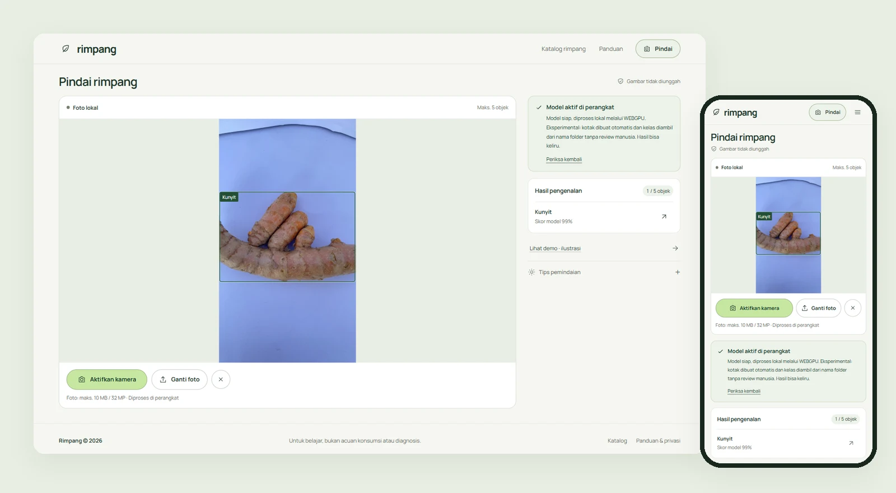
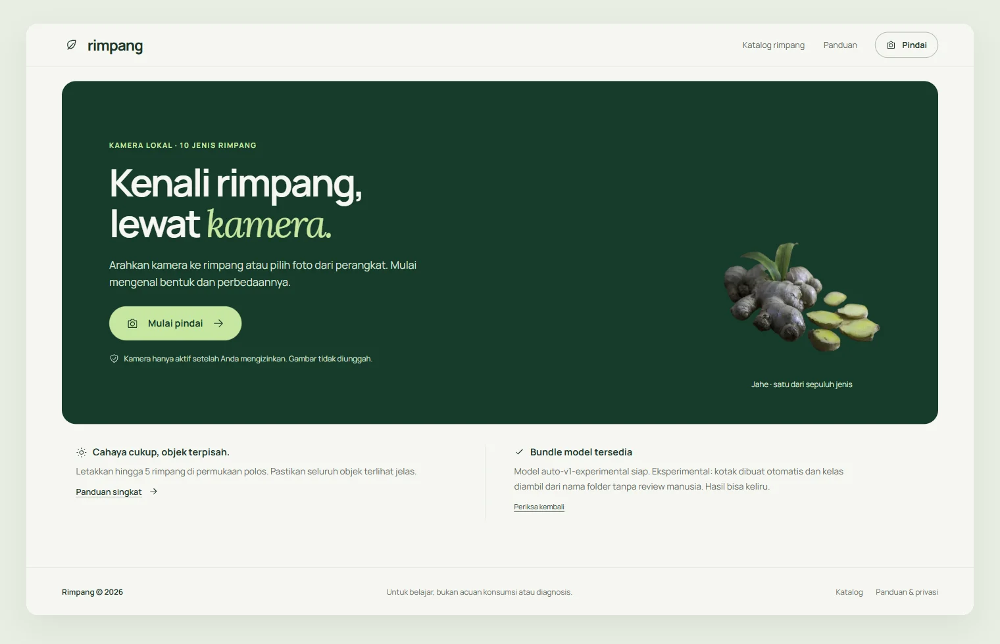
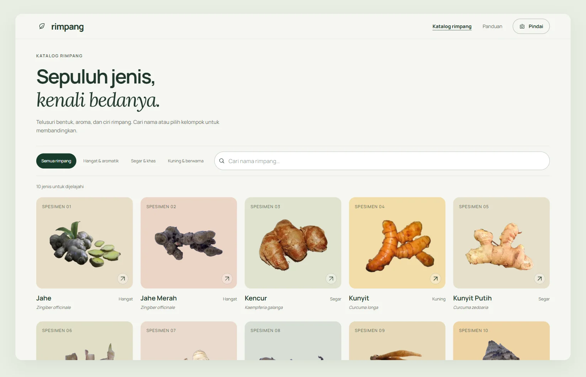
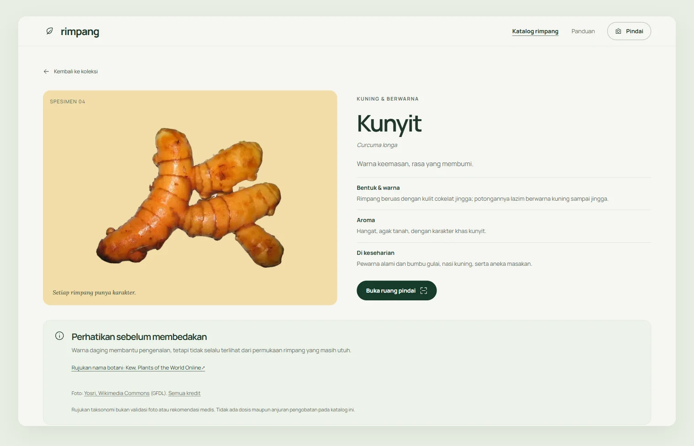
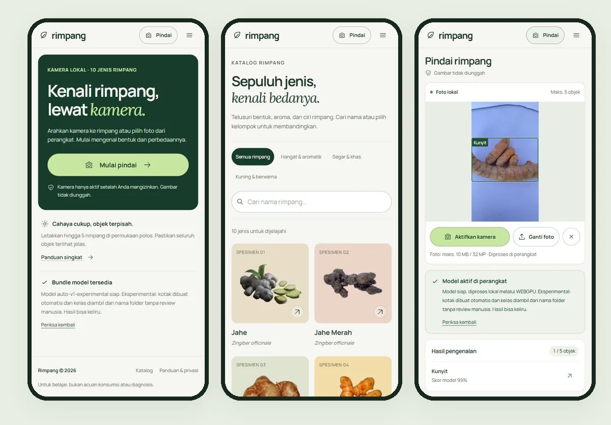
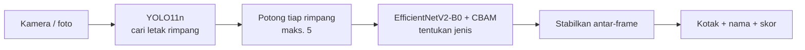

<div align="center">

# Tanaman Rimpang

**Kenali rimpang lewat kamera, langsung di browser.**




[Preview](#preview) · [Fitur](#fitur) · [Cara kerja](#cara-kerja) ·
[Akurasi](#hasil-akurasi-model) · [Penelitian](#konteks-penelitian) · [Menjalankan](#menjalankan)

</div>

Aplikasi web untuk mengenali jenis rimpang lewat kamera. Arahkan kamera HP atau
laptop ke rimpang, lalu aplikasi akan memberi kotak pada tiap rimpang yang
terlihat beserta nama jenisnya. Pengenalan berjalan di browser, jadi gambar
tidak dikirim ke server mana pun.

Ada 10 jenis yang bisa dikenali: jahe, jahe merah, kencur, kunyit, kunyit
putih, lempuyang, lengkuas, temu hitam, temu kunci, dan temulawak.

| 10 jenis | 5 rimpang | 98% | 0 upload |
| :---: | :---: | :---: | :---: |
| rimpang dikenali | sekaligus per frame | jenis benar setelah terdeteksi | semua diproses di perangkat |

## Preview

| Beranda | Katalog |
| --- | --- |
|  |  |
| **Detail rimpang** | **Tampilan HP** |
|  |  |

## Fitur

- Pindai langsung dari kamera, sampai 5 rimpang sekaligus. Kalau hanya satu
  rimpang, labelnya cukup nama jenis; kalau lebih, tiap rimpang diberi nomor
  1–5 yang tetap stabil selama objek terlihat.
- Bisa juga memakai foto dari galeri.
- Katalog berisi keterangan setiap jenis rimpang, bisa dicari dan difilter per
  kelompok. Pencarian dan filter tersimpan di URL (`/jelajah?q=temu&kelompok=...`),
  jadi tautannya bisa dibagikan.
- Tampilan responsif, sudah diuji dari layar 280px sampai 2560px, termasuk HP
  posisi landscape, tablet, dan monitor lebar.

## Cara kerja



1. **Mencari** – YOLO11n melihat gambar (diperkecil ke 416×416) dan menandai
   setiap benda yang berupa rimpang dengan kotak. Model ini belum peduli
   jenisnya, hanya "ini rimpang atau bukan".
2. **Memotong** – tiap kotak dipotong dengan sedikit ruang tambahan (10%) lalu
   diubah ke 224×224. Maksimal 5 rimpang diproses per frame.
3. **Mengenali** – EfficientNetV2-B0 dengan modul attention CBAM menilai tiap
   potongan dan memberi skor untuk 10 jenis rimpang. CBAM membantu model
   memberi bobot lebih pada saluran warna dan area gambar yang paling
   membedakan.
4. **Menstabilkan** – saat memakai kamera, setiap rimpang diikuti dari frame ke
   frame. Skor dihaluskan agar label tidak berkedip, dan jenis baru ditampilkan
   setelah hasilnya sama di dua frame berturut-turut.
5. **Menampilkan** – kalau skor tertinggi di bawah 65%, rimpang ditandai
   "belum dikenali" alih-alih menebak.

Semua langkah berjalan di browser memakai ONNX Runtime Web: WebGPU bila
tersedia, dan otomatis beralih ke CPU (WASM) bila tidak. Gambar tidak pernah
dikirim ke server.

## Model

| Tahap | Model | Input | Ukuran file | Ambang |
| --- | --- | --- | --- | --- |
| Deteksi | YOLO11n (1 kelas: rimpang) | 416×416 | ~10 MB | skor ≥ 0,50, IoU NMS 0,45 |
| Klasifikasi | EfficientNetV2-B0 + CBAM (10 kelas) | 224×224 | ~24 MB | skor ≥ 0,65 |

Kedua model dilatih dengan PyTorch lalu diekspor ke ONNX. Dataset berisi
5.379 foto yang dibagi per kelompok foto agar foto yang mirip tidak bocor
antar-bagian: 3.760 latih, 795 validasi, dan 824 uji. Ambang dipilih memakai
data validasi, lalu data uji dipakai sekali untuk laporan di bawah.

## Hasil akurasi model

Diukur pada data uji (824 foto, 1.044 rimpang) memakai ambang yang sama
dengan aplikasi.

| Tahap | Metrik utama | Nilai |
| --- | --- | --- |
| Deteksi (YOLO11n) | mAP@50 | **86,6%** |
| Klasifikasi (EfficientNetV2-B0 + CBAM) | Akurasi jenis pada rimpang yang terdeteksi | **98,2%** |
| Keseluruhan | Precision hasil yang ditampilkan | **88,8%** |
| Keseluruhan | Rimpang yang ditemukan dan dikenali benar | **74,2%** |

<details>
<summary>Rincian metrik</summary>

**Deteksi**

| Metrik | Nilai |
| --- | --- |
| mAP@50 / mAP@50–95 (cara hitung Ultralytics) | 86,6% / 78,0% |
| Precision / recall (ambang aplikasi) | 89,2% / 75,9% |

**Klasifikasi**

| Potongan yang dinilai | Akurasi | Macro F1 |
| --- | --- | --- |
| Hasil deteksi model | 98,2% | 98,4% |
| Kotak asli (ground truth) | 94,5% | 95,0% |

**Keseluruhan:** macro F1 82,3%.

**F1 per jenis** (kotak asli, dengan ambang aplikasi)

| Jenis | F1 | Jenis | F1 |
| --- | --- | --- | --- |
| Lengkuas | 99,6% | Kunyit | 94,4% |
| Jahe merah | 99,0% | Temulawak | 93,9% |
| Lempuyang | 98,9% | Temu hitam | 92,6% |
| Temu kunci | 97,8% | Kunyit putih | 91,9% |
| Jahe | 95,0% | Kencur | 88,3% |

</details>

Artinya, kalau sebuah rimpang sudah terdeteksi, jenisnya hampir selalu
benar. Titik lemahnya ada di tahap deteksi: sekitar seperempat rimpang
terlewat, terutama pada foto yang berisi banyak rimpang berdempetan (pada foto
berisi 5 rimpang, hanya ~23% yang terdeteksi). Untuk hasil terbaik, pindai
satu sampai beberapa rimpang yang tidak saling menumpuk.

> [!WARNING]
> Model ini masih **eksperimental**: kotak pada dataset dibuat otomatis dan
> label diambil dari nama folder tanpa pemeriksaan manual, serta belum diuji
> terhadap foto yang bukan rimpang.

## Hasil uji kamera

Selain evaluasi model di atas, aplikasi juga diuji lewat kamera tiruan
(Playwright) yang memutar 30 foto uji, 3 per jenis, dengan beberapa gangguan.
Angka di bawah adalah tebakan pertama yang benar.

| Kondisi | Benar | Kondisi | Benar |
| --- | --- | --- | --- |
| Normal | 28/30 | Buram (blur 3px) | 30/30 |
| Diputar 30° | 29/30 | Objek jauh (skala 50%) | 29/30 |
| Diputar 90° | 30/30 | Noise sedang | 27/30 |
| Gelap 50% | 27/30 | Noise berat | 22/30 |
| Terlalu terang 150% | 23/30 | **Total** | **245/270 (91%)** |

Model paling sering keliru pada kunyit putih (sering tertebak temu hitam),
serta saat cahaya terlalu terang atau gambar sangat berbintik. Ini uji
ringan, bukan evaluasi resmi.

## Konteks penelitian

Proyek ini adalah implementasi penelitian identifikasi rimpang obat lokal
Sulawesi Selatan dengan pendekatan hibrida **lokalisasi (YOLOv11) →
klasifikasi (EfficientNetV2 + transfer learning) → atensi (CBAM)**, dilengkapi
Grad-CAM agar keputusan model bisa ditelusuri.

**Rumusan masalah dan cara repo menjawabnya**

| Rumusan masalah | Implementasi |
| --- | --- |
| 1. Merancang sistem identifikasi rimpang berbasis YOLOv11 + EfficientNetV2-CBAM | `training/scripts/train_detector.py`, `train_classifier.py`, aplikasi web `web/` |
| 2. Mengukur kinerja (akurasi, presisi, recall, F1) | `evaluate_models.py` → `evaluation-report.json` (ambang dipilih di validasi, uji sekali) |
| 3. Mengukur kontribusi YOLOv11 dan CBAM | studi ablasi `run_ablation.py` (penuh vs tanpa CBAM vs tanpa YOLO) |
| 4. Menilai ketahanan dan keterjelasan model | `run_robustness.py` (kondisi foto + degradasi) dan `gradcam.py` |

**Kebaruan yang didukung kode**

- Dataset lokal dengan `specimenId` per rimpang fisik, metadata pengambilan
  (lokasi, pencahayaan, latar, kondisi), dan tanda `expertValidated`.
- Pembagian latih/validasi/uji **per spesimen**: foto dari spesimen yang sama
  tidak pernah tersebar ke dua bagian.
- Studi ablasi dan uji ketahanan pada citra uji yang sama, plus Grad-CAM yang
  mengukur berapa persen perhatian model jatuh di dalam kotak rimpang.

**Target dan peta jalan**

| Fase | Fokus | Target |
| --- | --- | --- |
| 1 | Dataset lokal tervalidasi ahli, model hibrida, evaluasi + ablasi | akurasi uji **≥ 85%** (dicatat di `researchTarget` laporan evaluasi) |
| 2 | Uji lapangan, ketahanan kondisi nyata, perluasan jenis | — |
| 3 | Pemanfaatan oleh petani, UMKM jamu, dan pendidikan | — |

Penelitian ini mendukung SDGs 3 (kesehatan, obat herbal yang tepat jenis),
SDGs 8 (nilai ekonomi rimpang bagi petani/UMKM), dan SDGs 9 (inovasi
teknologi), sejalan dengan Rencana Induk Riset Nasional bidang kesehatan dan
pangan.

> [!IMPORTANT]
> Angka di [Hasil akurasi model](#hasil-akurasi-model) berasal dari dataset
> sekunder berlabel otomatis. Klaim penelitian baru sah setelah model dilatih
> ulang dengan dataset lokal Sulsel yang divalidasi ahli.

### Mengumpulkan dataset lapangan

Setiap gambar di manifest (`shared/dataset-manifest.schema.json`) sebaiknya
mencatat:

```json
{
  "specimenId": "kunyit-maros-007",
  "expertValidated": true,
  "capture": {
    "location": "maros", "lighting": "matahari-langsung",
    "background": "tanah", "condition": "dipanen"
  }
}
```

- Satu `specimenId` = satu rimpang fisik; foto dari beberapa sudut memakai ID
  yang sama.
- `condition` salah satu dari `lapangan`, `dipanen`, `dibersihkan`, `diiris`.
- Variasikan pencahayaan, latar, dan lokasi agar uji ketahanan per kondisi
  bermakna; gambar tanpa metadata dilaporkan sebagai `tidak-dicatat`.

### Protokol eksperimen

Jalankan dari folder root setelah `evaluate_models.py` menghasilkan
`frozen-thresholds.json` untuk model penuh (path `runs/...` hanya contoh;
sesuaikan dengan lokasi checkpoint Anda).

```powershell
# Ablasi: latih varian tanpa CBAM dan tanpa YOLO, lalu bandingkan
python -m training.scripts.train_classifier --data prepared/classifier --config training/configs/classifier.no-cbam.json --output runs/no-cbam
python -m training.scripts.run_ablation build --prepared prepared
python -m training.scripts.train_classifier --data prepared/ablation-whole-image --output runs/whole-image
python -m training.scripts.run_ablation evaluate --prepared prepared --data-root data --detector runs/detector/best.pt --full runs/classifier/best.pt --no-cbam runs/no-cbam/best.pt --whole-image runs/whole-image/best.pt --frozen runs/eval/frozen-thresholds.json --output runs/ablation

# Ketahanan: degradasi sintetis (gelap, terang, kontras rendah, buram, noise, JPEG)
python -m training.scripts.run_robustness --prepared prepared --data-root data --detector runs/detector/best.pt --classifier runs/classifier/best.pt --frozen runs/eval/frozen-thresholds.json --output runs/robustness.json

# Grad-CAM: overlay per kelas + proporsi aktivasi di dalam kotak rimpang
python -m training.scripts.gradcam --prepared prepared --data-root data --classifier runs/classifier/best.pt --output runs/gradcam
```

Metrik per kondisi foto nyata (`captureStrata`) sudah otomatis masuk ke
laporan `evaluate_models.py`.

## Teknologi

| Bagian | Teknologi |
| --- | --- |
| Web | Next.js 16, React 19, TypeScript, Tailwind CSS 4 |
| Pelatihan | PyTorch, Ultralytics (YOLO11n), timm (EfficientNetV2-B0) |
| Inferensi | ONNX Runtime Web (WebGPU / WASM) |

## Menjalankan

Pastikan Node.js versi 22.18 atau lebih baru sudah terpasang.

```powershell
cd web
npm ci
npm run dev
```

Buka http://localhost:3000 lalu masuk ke menu **Pindai**. Untuk versi
produksi, jalankan `npm run build` kemudian `npm start`.

> [!NOTE]
> Browser hanya mengizinkan kamera di `localhost` atau HTTPS. Untuk mencoba
> dari HP di jaringan yang sama, pakai tunnel HTTPS atau unggah foto dari
> galeri.

Perintah pemeriksaan (jalankan di folder `web`):

```powershell
npm run lint
npm run typecheck
npm test
npm run build
```

## Struktur folder

```text
web/       aplikasi web beserta model ONNX
shared/    daftar kelas dan format data
training/  pengolahan dataset dan pelatihan model
docs/      gambar preview README
```

## Kredit foto katalog

Foto katalog di `web/public/images/rimpang/` sudah dihapus latarnya agar
setiap rimpang tampil utuh. Lima foto berasal dari Wikimedia Commons dan
satu dari Flickr; semuanya tetap memakai lisensi aslinya (CC BY / CC BY-SA /
GFDL). Empat foto lainnya diambil dari dataset proyek. Rincian penulis dan
lisensi ada di `web/src/data/image-credits.json` dan ditampilkan di halaman
Panduan.

## Lisensi

Kode di repositori ini memakai [MIT License](LICENSE). Dataset dan pustaka
pihak ketiga mengikuti lisensinya masing-masing.